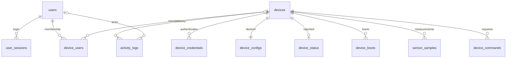

# Smart Pool database và API v2 – nhiều thiết bị

## Phạm vi đã triển khai trong source

Database/API được tái cấu trúc cho admin quản lý nhiều thiết bị và nhiều user cùng quản lý một thiết bị. Đây là bản không tương thích API một thiết bị trước đây. **Đã reset và triển khai baseline 004 trên Pi `192.168.60.87` ngày 17/11/2026 theo yêu cầu.** Health LAN/Cloudflare trả HTTP 200; DB có 12 bảng, một admin, chưa có thiết bị hoặc mẫu đo. Chưa chạy collection Postman hoặc kiểm thử nghiệp vụ. Các bước bên dưới dành cho lần cài đặt/reset tiếp theo, không cần chạy lại trên Pi vừa triển khai.

Admin mới dùng username `admin`; credential hiện tại lưu riêng tại `~/smartpool-v2-credentials.txt` trên Pi (quyền 600), không dùng mật khẩu ứng dụng cũ. Backup trước reset và source/image API cũ được giữ tại `/home/qnm/smartpool-rollbacks/v2-20261117-223404/`, cần sudo để đọc. Không đưa nội dung credential hoặc dump vào Git/log.

Không nhập/chuyển dữ liệu cũ. Reset là lệnh CLI riêng có cờ rõ ràng; `migrate.php`, `deploy.sh` và `pool.sh up` không tự xóa database. Firmware, app Android và topic/ACL MQTT hiện chưa chuyển sang hợp đồng v2; BLE chưa triển khai. Không đưa bản API này vào hệ thống đang dùng client cũ mà kỳ vọng mọi chức năng tiếp tục hoạt động.

## Mô hình quan hệ



| Bảng | Vai trò |
| --- | --- |
| `users` | Username unique phân biệt hoa thường; password hash; full_name/MSSV; role `admin` hoặc `user`; active |
| `user_sessions` | Hash token, user và hạn phiên; khóa tài khoản/đổi mật khẩu thu hồi phiên |
| `devices` | `device_id` ổn định ASCII tối đa 64 ký tự, tên, họ tên/MSSV, owner metadata, active, người/giờ đăng ký, nguồn manual/ble |
| `device_users` | PK `(device_id,user_id)`; quyền view/control/configure; một user nhiều thiết bị, một thiết bị nhiều user |
| `device_credentials` | Key HTTP riêng từng thiết bị; chỉ lưu SHA-256 hash, hỗ trợ nhiều key và thu hồi |
| `device_configs` | Cấu hình mong muốn từng thiết bị: revision, ngưỡng nhiệt/ADC, hiệu chuẩn cm, interlock, quy tắc tự động |
| `device_status` | Trạng thái ESP báo: relay, cảm biến bật/tắt, SSID/IP, boot/sequence, revision đã áp dụng, giờ báo/nhận |
| `device_boots` | Ghi nhận boot đã thấy để không áp lại trạng thái của phiên boot cũ |
| `sensor_samples` | UNIQUE `(device_id,sample_id)`; giờ đo nullable và giờ nhận riêng; số đo nullable; thông tin gửi bù |
| `device_commands` | Yêu cầu điều khiển có user/device, TTL, request_id chống trùng và kết quả ACK; chưa có publisher MQTT |
| `activity_logs` | Nhật ký theo thiết bị, actor, nguồn backend/client/device; audit tài khoản có thể không gắn device |
| `schema_migrations` | Phiên bản/checksum baseline mới và migration tiếp theo |

`owner_user_id` chỉ là liên hệ/chủ sở hữu, không quyết định toàn bộ người được quản lý. Admin toàn hệ thống có thể xem/quản trị mọi thiết bị. User thường chỉ được truy cập thiết bị active có dòng membership hợp lệ. Mặc định quyền của một thành viên trong schema là đủ ba quyền; API vẫn yêu cầu admin gửi rõ cả ba boolean khi cấp/sửa, không cấp quyền ngầm từ owner hoặc ID BLE.

Gỡ thành viên chỉ DELETE một dòng `device_users`; không xóa user, số đo, config, audit hoặc quyền trên thiết bị khác. Không có API xóa vĩnh viễn tài khoản/thiết bị trong đợt này: dùng khóa user/inactive thiết bị hoặc gỡ membership. Lịch sử vẫn còn để truy vết.

## Luồng sử dụng và quyền

Admin đăng nhập → response trả trang danh sách thiết bị → nhập ID để đăng ký → activate → thêm user vào từng thiết bị. Sau này BLE đọc ID trước bước đăng ký; `registration_source=ble` hiện chỉ là metadata do admin khai báo, không chứng minh điện thoại đã quét hoặc đang ở gần ESP.

User đăng nhập → response trả danh sách thiết bị được view → chọn device_id → gửi device_id trong mọi request trạng thái, lịch sử, cấu hình, lệnh và nhật ký. Thiết bị không được cấp hoặc inactive bị API chặn; backend không tự suy ra thiết bị duy nhất/mặc định `id=1`.

| Quyền | Truy cập API |
| --- | --- |
| `can_view` | Chi tiết thiết bị, trạng thái, cấu hình, biểu đồ/lịch sử và nhật ký của thiết bị, gồm thao tác các thành viên khác |
| `can_control` | Tạo yêu cầu điều khiển, gửi nhật ký client liên quan bơm |
| `can_configure` | Lưu ngưỡng/hiệu chuẩn/interlock/tự động hóa; nhật ký client cấu hình Wi-Fi |
| Admin | Thêm/khóa user; đăng ký/kích hoạt thiết bị; đổi owner; xem/thêm/sửa/gỡ thành viên; cấp/thu hồi credential; audit toàn hệ thống |

Control/configure không thể có khi thiếu view. User có quyền cấu hình vẫn không được thêm thành viên hoặc cấp credential. Wi-Fi password không lưu trong DB/API/log: dự kiến điện thoại gửi trực tiếp qua BLE khi ở gần ESP, kể cả khi ESP mất mạng. API ghi được nhật ký client của quá trình đó nhưng chưa thực hiện BLE, kiểm tra khoảng cách hoặc khôi phục mạng. SSID/IP hiện chỉ là thông tin ESP báo.

<a id="cai-moi-hoac-reset-database-cu"></a>

## Cài mới hoặc reset database cũ

Schema chuẩn là [004_multi_device.sql](../backend/migrations/004_multi_device.sql). `pool_db.sql` là bản bootstrap tương ứng cho DB trống. Các file 001–003 là lịch sử của mô hình cũ, runner mới không chạy chúng.

Với DB trống, script triển khai khởi tạo schema và ghi ledger. Với DB có `pool_*`, runner dừng, yêu cầu reset rõ ràng. Không seed admin, thiết bị, user hoặc credential thử nghiệm.

**Các lệnh dưới đây xóa toàn bộ dữ liệu Smart Pool trong database được cấu hình.** Không chạy nếu chưa muốn mất tài khoản, thiết bị, mẫu đo, cấu hình và nhật ký. Không xóa volume Docker hoặc database bằng `down -v`. Có thể tự tạo backup trước để quay lui; yêu cầu hiện tại không giữ/chuyển dữ liệu cũ sang mô hình mới.

Sau khi chép source mới lên Pi, tại `~/smartpool-v2/deploy/raspberry-pi-v2`:

```bash
# Tùy chọn: tạo backup riêng trước khi reset.
sudo bash pool.sh backup

# Dừng API cũ để không có request ghi trong lúc reset.
sudo docker compose -f compose.yaml -f compose.cloudflare.yaml stop api
sudo docker compose -f compose.yaml -f compose.cloudflare.yaml build api

# BƯỚC PHÁ HỦY DỮ LIỆU: chỉ người vận hành chủ động chạy.
sudo docker compose -f compose.yaml -f compose.cloudflare.yaml run --rm --no-deps -T api php /opt/smartpool/reset_database.php --reset-all-smartpool

# Tạo admin mới; tên đầy đủ và mật khẩu nhập tương tác, không đưa secret vào argv.
sudo docker compose -f compose.yaml -f compose.cloudflare.yaml run --rm --no-deps api php /opt/smartpool/create_admin.php
sudo docker compose -f compose.yaml -f compose.cloudflare.yaml up -d --no-deps --no-build api
```

DB phải đang chạy. Chỉ API bị thay; MQTT, Cloudflare và credential MQTT chưa đổi. Reset không làm credential MQTT chung tự hết hiệu lực. Thiết bị/app cũ không thể dùng HTTP v2; dừng/thay cấu hình chúng theo kế hoạch tích hợp, tránh hàng đợi upload cũ lặp lỗi.

CLI reset chỉ DROP danh sách bảng Smart Pool v1/v2 đã biết, từ chối trước khi DROP nếu gặp bảng lạ trong DB. Không DROP DATABASE, không import dữ liệu cũ, không tự tạo backup. DDL có implicit commit: nếu lỗi sau một số DROP có thể còn DB dở dang; sửa nguyên nhân rồi chạy lại reset. Advisory lock ngăn hai CLI migration/reset cùng chạy, không ngăn API cũ ghi nên bước dừng API là bắt buộc.

Sau baseline, các lần cập nhật thông thường dùng:

```bash
sudo docker compose -f compose.yaml -f compose.cloudflare.yaml build api
sudo docker compose -f compose.yaml -f compose.cloudflare.yaml run --rm --no-deps -T api php /opt/smartpool/migrate.php
sudo docker compose -f compose.yaml -f compose.cloudflare.yaml up -d --no-deps --no-build api
```

Runner chuẩn hóa CRLF/LF khi tính checksum; không sửa migration đã áp dụng. Bổ sung migration số 005 trở đi cho thay đổi sau này. Tất cả kết nối v2 dùng UTC; thời gian ISO trong JSON DATETIME phải được client hiểu là UTC, còn các trường `_ms` là Unix milliseconds.

## Hợp đồng API v2

URL vẫn `/pool_api/pool_api.php`; POST JSON cho mọi action, trừ GET `?action=health` không cần đăng nhập. GET trạng thái/history/commands cũ và payload legacy không còn hỗ trợ. Response có `api_version:2`, `status:success/error`.

Người dùng gửi `Authorization: Bearer TOKEN`. ESP gửi `X-Pool-Device-Key: KEY` cùng `device_id`; token người dùng không thay key ESP. Truy cập ngoài LAN dùng HTTPS. Response không cache. Key/token chỉ trả lúc tạo; server chỉ lưu hash. Không export response chứa secret từ Postman.

| Action | Ai gọi | Nội dung chính |
| --- | --- | --- |
| `login` | Chưa đăng nhập | username/password/remember_me; trả user, token, expires_in, devices và next_after_device_id |
| `logout` | User | Thu hồi đúng phiên Bearer đang dùng |
| `list_users` | Admin | limit 1..100, after_id; không trả password hash |
| `create_user` | Admin | username, full_name, password admin 7..72 byte hoặc user 8..72 byte, role admin/user, student_code tùy chọn |
| `set_user_active` | Admin | user_id, is_active; không tự khóa mình/khóa admin cuối cùng |
| `set_user_password` | Admin | user_id, password; thu hồi mọi phiên của user đó |
| `register_device` | Admin | device_id, name, student_full_name, student_code, owner_user_id tùy chọn; thiết bị inactive, config revision=1 |
| `list_devices` | User | limit 1..100, after_device_id; user chỉ thấy thiết bị được view |
| `get_device` | View | device_id; trả ba quyền; metadata riêng chỉ admin thấy |
| `set_device_active`, `set_device_owner` | Admin | device_id và is_active/owner_user_id |
| `set_device_member` | Admin | device_id, user_id, ba cờ can_view/control/configure; can_view phải true |
| `remove_device_member` | Admin | device_id, user_id; không xóa user |
| `list_device_members` | Admin | device_id; trả thành viên, quyền và trạng thái tài khoản |
| `create_device_credential` | Admin | device_id active, label; trả credential_id/device_key một lần |
| `list_device_credentials`, `revoke_device_credential` | Admin | device_id, credential_id khi revoke; list không có key/hash |
| `get_status` | View | device_id; trạng thái báo cáo và hai loại mẫu mới nhất |
| `get_config` | View | device_id; cấu hình mong muốn |
| `update_config` | Configure | device_id, expected_revision, settings; lưu revision mới, chưa đẩy MQTT |
| `get_history` | View | device_id, time_basis, from_ms/to_ms, limit, cursor |
| `list_activity` | View | device_id, limit 1..500, before_id; nhật ký mọi thành viên của thiết bị |
| `record_activity` | Control/Configure | device_id, event_id/request_id UUID, event_action, occurred_at_ms nullable; nguồn luôn client |
| `list_admin_audit` | Admin | limit/before_id; chỉ source=backend, toàn hệ thống |
| `request_control` | Control | device_id, request_id UUID, target pump_in/pump_out, enabled boolean, ttl_seconds 1..60 |
| `get_command` | View | device_id, command_id; trạng thái lưu và effective_status tính thêm hết hạn |
| `device_identity` | ESP key | device_id; kiểm tra xác thực |
| `upload_sample` | ESP key | device_id, sample_id, measured_at_ms/time_quality, temperature/water_adc, is_backfill |
| `report_status` | ESP key | device_id, boot_id, state_sequence, bốn cờ trạng thái; SSID/IP/revision/giờ báo tùy chọn |
| `get_device_config` | ESP key | device_id; đọc cấu hình mong muốn để tích hợp firmware sau |
| `acknowledge_command` | ESP key | device_id, command_id, result applied/rejected; không chấp nhận lệnh hết hạn |

Đăng ký/cấp key/tạo user và chèn mẫu mới trả 201. Action khác/retry mẫu trả 200. Sai đầu vào 400; thiếu/sai/thu hồi xác thực 401; thiếu quyền/inactive 403; không có đối tượng 404; trùng ID/nội dung/revision/sequence 409; body quá 64 KiB trả 413. Lỗi DB trả 500 chung, không in SQL/secret. JSON boolean/number phải đúng kiểu, không dùng chuỗi `"false"`, `"123"` thay boolean/number.

## Thời gian, gửi bù, trạng thái

Mẫu mới có dạng:

```json
{
  "action":"upload_sample",
  "device_id":"ho_ten_MSSV_01",
  "sample_id":"0000000100000001",
  "measured_at_ms":null,
  "time_quality":"unknown",
  "temperature":27.5,
  "water_adc":2200,
  "is_backfill":true
}
```

Nếu đồng hồ đã đồng bộ khi lấy mẫu, gửi giờ đo thật và `time_quality=synced`; nếu chưa biết để null/unknown, không lấy giờ gửi bù thay giờ đo. Thời gian đã biết phải từ năm 2020 và không quá giờ server 5 phút. Giờ nhận do MariaDB UTC tạo lần đầu. Retry cùng device/sample với cùng nội dung chuẩn hóa trả duplicate và giữ giờ nhận cũ; nội dung khác trả 409. Cờ is_backfill có thể đổi khi retry, không tham gia hash nội dung; DB giữ giá trị lần nhận đầu.

Mẫu phải có ít nhất nhiệt độ hoặc ADC; không có giá trị thì gửi null/bỏ trường, không giả thành 0. `get_status` trả `latest_measured_sample` (chỉ mẫu có giờ đo) và `last_received_sample` riêng; gửi bù không ghi đè trạng thái relay hoặc bị gọi là mẫu đo mới nhất chỉ vì vừa nhận. Không có import/backfill dữ liệu v1.

Status là luồng live riêng, không gửi bù từ hàng đợi cảm biến: boot_id gồm 32 ký tự hex ngẫu nhiên mỗi boot, state_sequence tăng trong boot. Retry đúng sequence/nội dung không làm mới heartbeat. Sequence cũ, cùng sequence khác nội dung hoặc quay lại boot đã thay thế bị từ chối. Một boot chưa từng thấy được coi là phiên mới khi ESP xác thực báo live; server vẫn phải tin ESP về việc không gửi trạng thái offline vào endpoint live.

`is_recent_report` chỉ nghĩa HTTP status được nhận trong 120 giây, không chứng minh kết nối MQTT hoặc motor thực sự quay. Pump fields là trạng thái ESP báo; không có cảm biến phản hồi phần cứng. `config_revision_reported_matching` chỉ so revision ESP báo với revision mong muốn, không xác minh độc lập phần cứng.

## Cấu hình, Wi-Fi và điều khiển

`update_config` chấp nhận temperature_min/max, water_adc_min/max, water_cm_min/max, interlock và automation. Ngưỡng dưới phải nhỏ hơn ngưỡng trên; ADC 0..4095, nhiệt -55..125 °C, cm 0..100000. Automation tối đa hai kênh, điều kiện water (ADC)/temperature, duration 1..86400 giây, stop_mode duration/threshold; không lưu JSON tùy ý hoặc mật khẩu Wi-Fi. Thay đổi yêu cầu expected_revision đúng; xung đột trả 409 để client đọc lại trước khi sửa.

Response `delivery=stored_only` nghĩa chỉ lưu cấu hình, chưa có worker đồng bộ MQTT hoặc BLE. ESP có thể đọc bằng `get_device_config` khi firmware được tích hợp. Wi-Fi provisioning qua BLE và khôi phục offline là công việc tiếp theo trên Android/ESP; database không thể bảo đảm điện thoại đang ở gần thiết bị.

`request_control` tạo lệnh pending và audit, trả `delivery=not_published_by_api`. **Hiện chưa có MQTT publisher/outbox worker**, không coi response này là bơm đã chạy. Request_id lặp trên cùng device/user/target/enabled trả cùng lệnh; xung đột nội dung hoặc người gọi trả 409. Retry không gia hạn TTL. Gỡ membership, thu hồi control, khóa user hoặc inactive thiết bị sẽ hủy các lệnh pending tương ứng thành cancelled trong cùng giao dịch. ACK do credential của đúng thiết bị gửi, không phải xác nhận của motor vật lý. Lệnh hết hạn hiển thị effective_status=expired, chưa có job tự xóa hoặc tự thu gom pending. Worker tương lai phải kiểm tra lại quyền/active/TTL trước publish, không chỉ đọc một lệnh đã từng được chấp nhận.

Broker đã chuyển account/ACL theo thiết bị; xem [MQTT v2](mqtt-v2.md). ESP chỉ truy cập namespace của mình, app user không đăng nhập bằng tài khoản dùng chung. Worker backend publish lệnh/cấu hình chưa triển khai; membership/key HTTP vẫn chưa tự đồng bộ thu hồi account ESP. Operator dùng mqtt-admin.py để cấp/thu hồi riêng.

## Nhật ký, truy vấn và index

Admin thay đổi user/device/membership/credential, user cập nhật config hoặc tạo lệnh đều có nhật ký backend trong cùng transaction; audit lỗi thì thay đổi rollback. User không gửi actor/source/result backend. Nhật ký client chỉ nhận các mã pump_requested/confirmed/failed hoặc wifi_provisioning_requested/confirmed/failed, có kiểm tra control/configure; không nhận detail/payload tùy ý. Kết quả luôn `client_reported`, không nâng thành bằng chứng backend. Nhật ký device cũng ghi rõ `source=device`, `result=reported`.

`get_history` mặc định time_basis=received, limit=100 (max 500), sắp giảm dần; measured basis loại mẫu không biết giờ đo. `from_ms`, `to_ms` là khoảng bao gồm hai đầu. Cursor chứa device/basis/khoảng thời gian/khóa cuối và watermark ID, ngăn mẫu gửi bù mới chèn chen vào những trang đang đọc. Cursor không phải credential hoặc chữ ký; backend vẫn kiểm tra quyền và validate các giá trị. Vẽ biểu đồ thì client sắp mẫu tăng dần sau khi lấy các trang.

Index bám truy vấn: unique `(device_id,sample_id)`, `(device_id,measured_at_ms,id)`, `(device_id,received_at,id)`, membership `(user_id,device_id)`, nhật ký `(device_id,id)`, command theo device/thời gian và pending/expiry. Lọc giờ nhận so sánh trực tiếp cột received_at với FROM_UNIXTIME của tham số; không bọc cột trong hàm ở WHERE/ORDER. Chưa chạy EXPLAIN hoặc đánh giá hiệu năng thực tế.

## Kiểm tra bằng Postman và MQTT Web

Import [SmartPool.v2.postman_collection.json](../backend/postman/SmartPool.v2.postman_collection.json); chạy Collection Runner, 1 iteration, đủ thứ tự, không song song. Có 56 request với số thứ tự có hậu tố a/b. Điền local api_url, admin_username, admin_password, test_user_password (8..72 byte). Collection tạo **hai user test, hai thiết bị test, mẫu cảm biến giả và status OFF giả**, không dùng ID thiết bị thật. Nó để lại dữ liệu/audit, khóa hai user test, inactive hai thiết bị và revoke key khi kết thúc.

Token/key nằm trong biến runtime, không ghi vào collection/environment, nhưng response Postman vẫn nhạy cảm; không export/share response history. Không dừng giữa chừng; nếu dừng, dùng admin thu hồi key, inactive thiết bị/khóa user test và logout các phiên còn giữ. Các bản collection v1 đã bỏ vì hợp đồng API không còn đúng.

Các nhóm kiểm tra: login trả thiết bị; quan hệ hai user/hai thiết bị; admin quản lý membership; user bị chặn thiết bị ngoài quyền; config revision; ESP key khác session và khác thiết bị; mẫu gửi bù/trùng; phân trang/basis thời gian; status; lệnh OFF chỉ lưu queue; nhật ký có nguồn; gỡ một user không ảnh hưởng user/thiết bị khác; revoke và cleanup. Không publish MQTT hoặc bật bơm trong collection.

Bước ACK lệnh thử nghiệm có TTL 60 giây, chạy liền mạch; nếu dừng quá hạn, 409 là đúng, hãy tạo lệnh test mới để thử ACK. Collection chưa được chạy trong đợt phát triển này.

MQTT Web dùng account diagnostics riêng trong ~/smartpool-v2-mqtt-diagnostics.txt, WSS port 443/path /mqtt và topic smartpool/diagnostics/_smartpool_diag/probe. Không dùng android/esp32 hoặc key HTTP. Xem [hướng dẫn broker mới](mqtt-v2.md); MQTT credentials không tự đồng bộ từ membership DB.

## Backup, phục hồi và phần còn lại

`backup.sh` dump database hiện tại, bao gồm bảng v2; bảo vệ file dump và `.env` vì có thông tin cá nhân/hash. Chưa có job tự xóa/archive. Có thể đề xuất giữ số đo chi tiết 90–180 ngày, giữ audit lâu hơn và backup ngoài Pi; cần duyệt chính sách trước khi tự động hóa.

Sau reset, quay lại source v1 không khôi phục dữ liệu. Muốn quay lui phải phục hồi backup tương ứng vào DB phù hợp và chạy image/API cũ; nếu có dữ liệu v2 mới phải sao lưu trước khi thay. Không có down migration dựng lại dữ liệu đã xóa.

Việc tiếp theo trên Android: role user thay guest, giữ session v2, màn danh sách/chọn device_id, gắn context thiết bị vào mọi request/tab/log, phân quyền chức năng, đổi biểu đồ sang hai loại thời gian. Trên ESP: credential HTTP, payload v2, giữ thời điểm đo trong NVS, boot/sequence/status live, cấu hình revision và ACK. BLE và MQTT theo thiết bị cần thiết kế/tích hợp riêng. Đợt này chỉ database + API + tài liệu Postman theo phạm vi đã chọn.
