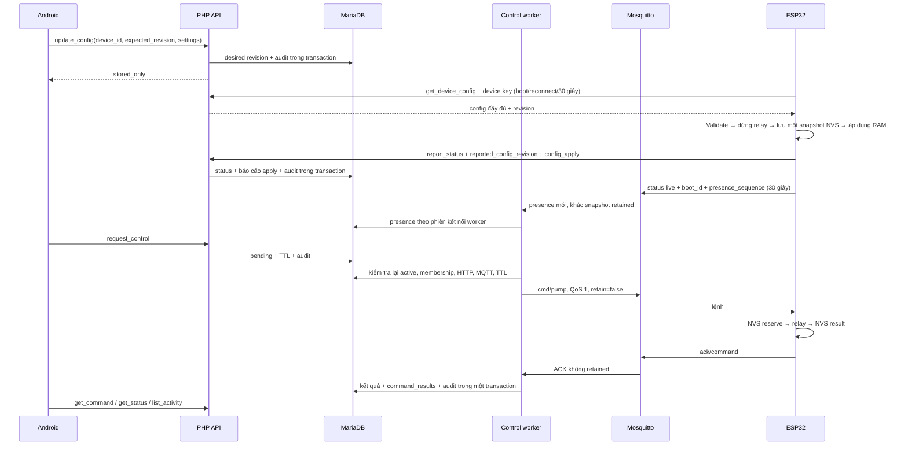

# ESP ↔ API/MQTT: hợp đồng runtime 005

Cập nhật ngày 18/11/2026. PHP API/worker và migration 005 đã triển khai Pi theo yêu cầu tiếp theo; health LAN/Cloudflare và heartbeat worker đã xác nhận, xem [ghi nhận triển khai](deployment-runtime-005.md). Firmware mới chưa build/flash, Android chưa sửa, chưa chạy collection Postman hoặc kiểm thử relay đầu cuối. Các hành vi ESP dưới đây mô tả source, chưa phải kết quả xác nhận trên phần cứng.

## Phạm vi và luồng thực tế



HTTP xác thực ESP bằng `X-Pool-Device-Key`; người dùng dùng Bearer. MQTT vẫn dùng username đúng `device_id` và ACL riêng theo thiết bị. Không đưa credential bridge cho app. Không đổi credential, policy hoặc file ACL trong đợt này.

`get_device_config` là nguồn cấu hình cho ESP. `config/desired` và `ack/config` vẫn có quyền trong ACL hiện tại nhưng firmware/worker mới không dùng chúng. ESP chỉ thực thi `cmd/pump` đúng namespace của mình, bỏ qua toàn bộ topic global cũ. Wi-Fi và endpoint vẫn cấu hình qua web/AP local, **chưa có BLE** và không nhận Wi-Fi qua API này.

## Cấu hình đã lưu và cấu hình đã áp dụng

- API `update_config` giữ nguyên optimistic locking `expected_revision`; `delivery=stored_only` chỉ nói giao dịch server đã lưu.
- ESP tải cả ngưỡng nhiệt độ, ngưỡng ADC, cặp hiệu chuẩn ADC/cm, interlock và hai rule automation. Rule không có trong mảng bị tắt. Điều kiện `{enabled:false}` không cần comparison/threshold.
- Rule bật cần relay/cảm biến tương ứng đang khả dụng. Nếu không, trả báo cáo lỗi `FEATURE_UNAVAILABLE`, giữ revision áp dụng trước đó.
- Mỗi revision mới được validate trước; hai relay dừng trước khi ghi snapshot. Nếu dừng relay/ghi NVS lỗi, không tăng revision báo cáo. Runtime automation cũ bị pause nếu quá trình đã bắt đầu dừng relay; thao tác này có thể làm bơm dừng dù apply thất bại.
- Sau khi ghi thành công một blob NVS không chứa credential, mới thay cấu hình RAM, reset automation và chờ mẫu cảm biến mới. Revision giống hệt snapshot hiện có không gây dừng bơm lại. Revision lùi hoặc cùng revision nhưng nội dung khác bị `REVISION_CONFLICT`.
- Khởi động lại phục hồi snapshot trước khi mở task điều khiển. Khi có snapshot managed, không dùng cấu hình boot ON hoặc rule cũ để bật relay trước khi phục hồi.
- Web/AP vẫn phục vụ Wi-Fi, endpoint, cảm biến và điều khiển local. Sau khi có snapshot server, thay rule automation qua local bị từ chối để tránh lệch revision; sửa bằng `update_config`.
- Firmware tiếp tục đo và điều khiển ngưỡng mực nước bằng **ADC**; cặp cm được lưu cùng cấu hình để client dùng hiệu chuẩn, không đổi số đo thành cm trong `upload_sample`.

ESP báo kết quả qua `report_status`:

```json
{
  "action": "report_status",
  "device_id": "DEVICE_RUNTIME_A",
  "boot_id": "0123456789abcdef0123456789abcdef",
  "state_sequence": 1,
  "pump_in": false,
  "pump_out": false,
  "temperature_enabled": true,
  "water_enabled": true,
  "reported_config_revision": 2,
  "config_apply": {"attempt_sequence": 1, "revision": 2, "result": "applied"}
}
```

Với lỗi: `config_apply.result="error"`, thêm `error_code` thuộc `INVALID_CONFIG`, `FEATURE_UNAVAILABLE`, `NVS_WRITE_FAILED`, `RELAY_STOP_FAILED`, `REVISION_CONFLICT`. `config_apply.revision` là revision thử áp dụng; `reported_config_revision` vẫn là revision áp dụng thành công trước đó, hoặc bỏ trống nếu chưa có. Không gửi nội dung lỗi tùy ý hoặc secret.

`(device_id,boot_id,attempt_sequence)` chống trùng báo cáo apply; cùng ID nhưng khác kết quả trả 409. ESP giữ cùng attempt để gửi lại đến khi status được server chấp nhận. Mất ACK HTTP có thể làm status_sequence tăng trong lần thử tiếp, nhưng không tạo audit apply trùng. Apply pending được gửi trước lần poll tiếp theo. Sau reboot, boot_id mới có chuỗi attempt mới. Báo cáo applied phải khớp `reported_config_revision` trong cùng request.

Pending apply report nằm trong RAM: lỗi chưa kịp gửi có thể mất khi mất nguồn. Snapshot đã lưu thành công được phục hồi và báo applied lại trong boot mới; chưa có hàng đợi NVS riêng cho mọi lần apply lỗi. HTTP chỉ được coi thành công khi response JSON API v2 đúng sample/state của request; HTML 200 hoặc redirect không làm xóa mẫu khỏi queue hay bỏ pending apply.

`get_status` thêm `config_apply` là báo cáo gần nhất (có `boot_id`) và vẫn có `desired_config_revision`, `config_revision_reported_matching`. Không dùng báo cáo của boot cũ để kết luận phiên hiện tại áp dụng thành công. Đây là xác nhận firmware, không phải xác minh cơ khí hoặc cấu hình an toàn thực địa.

## Dữ liệu đo và gửi bù

Firmware chụp `measured_at_ms` tại lúc tạo mẫu khi đồng hồ hợp lệ (SNTP hoặc giờ đã đặt qua cơ chế local hiện có). Mẫu trước đó giữ `null/time_quality=unknown`, kể cả khi SNTP đã đồng bộ trước lúc gửi lại. Không dùng giờ server nhận để thay giờ đo.

Queue NVS v3 giữ tối đa 128 mẫu, thêm thời điểm đo; v1/v2 được đọc bằng layout 16 byte cũ và chuyển sang layout 24 byte, giữ ID, thứ tự, giá trị, cờ; tất cả mẫu cũ có giờ đo unknown. Không sửa bản ghi MariaDB cũ. Queue đầy vẫn bỏ mẫu cũ nhất theo chính sách hiện có; queue RAM đầy vẫn có thể mất mẫu trước khi lưu NVS. Chưa có bảo đảm không mất dữ liệu vô hạn khi offline.

Task HTTP status/config tách khỏi task sensor replay. Backfill không cập nhật trạng thái live hoặc làm thiết bị được xem là online. `device_id+sample_id` vẫn là khóa chống trùng; gửi lại nội dung đo khác cùng ID trả 409.

## Readiness của từng thiết bị

`get_status.remote_control_ready` nay là tổng hợp các điều kiện trong `readiness`, thay cho kiểm tra file heartbeat chung:

| Thành phần | Điều kiện |
| --- | --- |
| Quyền | Device active; tài khoản admin hoặc membership có view + control |
| HTTP | Có report_status của thiết bị trong 90 giây |
| MQTT | Live status `online=true` trong 75 giây, boot_id trùng HTTP |
| Worker | Heartbeat DB trong 10 giây và đang kết nối broker |
| Phiên worker | Presence phải thuộc đúng connection_id worker hiện tại |

`readiness.http_report` chứa recent/age_ms/max_age_seconds; `mqtt_presence` chứa state/age_ms/max_age_seconds; `worker` chứa healthy/broker_connected/age_ms. `reasons` có `device_inactive`, `control_denied`, `worker_stale`, `worker_broker_disconnected`, `http_report_missing/stale`, `mqtt_presence_unknown/offline/stale`.

Retained status đọc khi subscribe chỉ ghi nhận snapshot, không nâng liveness. Khi worker reconnect/restart, chờ status live mới (ESP gửi mỗi 30 giây). LWT offline live đánh dấu offline; nếu bỏ lỡ LWT, thời hạn presence vẫn làm readiness false. Presence không trùng boot HTTP được coi unknown. Cờ legacy `state.is_recent_report` vẫn giữ cửa sổ 120 giây để tương thích, chỉ phản ánh HTTP và **không dùng làm readiness MQTT**.

Readiness là ảnh chụp, có thể đổi ngay sau response; chưa yêu cầu config revision matching để cho phép điều khiển. API vẫn nhận và lưu lệnh hợp lệ khi chưa ready; worker chỉ gửi khi đủ điều kiện. Nếu thiết bị không sẵn sàng trước TTL, lệnh expired.

## Lệnh và ACK

- Worker kiểm tra lại quyền trong transaction ngay trước khi publish; quét expired/cancelled cả khi broker mất kết nối. Thu hồi membership/control, inactive thiết bị, khóa/đổi mật khẩu user hủy lệnh pending qua backend và audit.
- `command_dispatch.last_enqueued_at` chỉ là đưa vào client MQTT thành công, không phải broker/ESP đã áp dụng. Không có distributed transaction giữa DB và MQTT; có thể gửi lại nếu publish thành công nhưng transaction DB lỗi.
- QoS 1 có thể lặp. ESP lưu 32 reservation/kết quả trong NVS, không đẩy một lệnh chưa hết TTL ra khỏi sổ để nhận lệnh khác. Đầy sổ thì từ chối. Cùng command_id nhưng payload khác bị từ chối. Không thực thi retained hoặc lệnh hết hạn/chưa có giờ hợp lệ.
- ESP reserve trước khi đổi relay. Nếu mất điện giữa relay và ghi kết quả, bản ghi còn uncertain; lần gửi lại bị rejected, không tự thực thi lại. Nếu ghi kết quả lỗi sau lệnh ON, firmware cố tắt các bơm remote. `get_status` mới là trạng thái relay được báo sau đó.
- ACK MQTT/HTTP đi đến một trạng thái cuối và một `command_results` + `command_finished` audit; ACK lặp không nhân bản. ACK trái kết quả cuối không thay trạng thái. HTTP ACK trễ/thu hồi quyền trả `accepted=false` và kết quả expired/cancelled; MQTT ACK trễ không nâng thành applied.
- Worker dùng MQTT clean session và tạo client mới sau disconnect để bỏ outbox cũ. Lệnh đã truyền ra broker/đang đến ESP trước lúc thu hồi quyền không thể thu hồi nguyên tử; firmware tiếp tục kiểm tra TTL nhưng không tự tra membership. Không tuyên bố đã chặn tuyệt đối mọi lệnh đang bay.
- Broker vẫn không tra DB khi kết nối. Vô hiệu HTTP key/device không tự revoke account Mosquitto; người vận hành dùng công cụ MQTT hiện có khi cần ngắt credential. Chính sách mật khẩu hiện tại có thể cho phép giả mạo username khác nếu biết mật khẩu dùng chung theo nhóm; chưa giải quyết phần cấp secret riêng trong đợt này.

## Migration và quay lui (người vận hành tự thực hiện)

Migration mới [005_device_runtime.sql](../backend/migrations/005_device_runtime.sql) chỉ thêm 5 bảng; không sửa 004, không xóa/đổi dữ liệu cũ, không dùng reset/down -v. Terminal commands cũ không được bịa ACK/audit để điền ledger; chỉ các chuyển trạng thái sau nâng cấp có ledger mới. Pending cũ được worker kiểm tra lại; TTL cũ vẫn giữ nguyên.

Người vận hành sao lưu theo quy trình hiện có và giữ bản source/image cũ. Dừng worker khi nâng cấp, build image API/worker, chạy `php /opt/smartpool/migrate.php` bằng image mới trước khi mở API/worker mới. Các lệnh tương đương quy trình đã thực hiện trong thư mục deploy v2:

```bash
sudo docker compose stop control-worker
sudo docker compose build api control-worker
sudo docker compose run --rm --no-deps -T api php /opt/smartpool/migrate.php
sudo docker compose up -d --no-deps api control-worker
```

Health mới yêu cầu các bảng 005 tồn tại (`schema_runtime=5`). Không bỏ qua lỗi migration để khởi động tiếp. DDL MariaDB có implicit commit: nếu migration dở dang, kiểm tra lỗi và chạy lại runner; CREATE IF NOT EXISTS giữ bảng đã tạo, checksum chỉ ghi khi hoàn tất. Không sửa file migration đã áp dụng.

Quay lui API/worker bằng image/source trước nâng cấp, giữ nguyên 5 bảng bổ sung và dữ liệu. Không drop bảng hoặc xóa schema_migrations để rollback. Worker cũ không ghi ledger mới nên báo cáo audit runtime sẽ có khoảng trống trong thời gian quay lui.

Firmware: giữ bản firmware/NVS trước nâng cấp. Queue v3 không đọc được bằng firmware chỉ hiểu v1/v2; trước downgrade phải gửi hết queue hoặc dùng công cụ chuyển đổi đã duyệt, không erase NVS để né lỗi. Các blob legacy automation/settings được giữ nhưng có thể không phản ánh cấu hình server mới; không rollback firmware để tự bật automation cũ. Khi restore DB về revision thấp hơn snapshot ESP, xử lý đối soát/reprovision có chủ đích, không tự coi revision mới hơn trên ESP là hợp lệ với DB đã restore.

## Các việc cần làm trên Android (chưa sửa code)

1. Dùng `readiness` cho sơ đồ Hệ thống và thông báo lý do chặn điều khiển. Phân biệt HTTP mới, MQTT online/offline/unknown/stale và worker khỏe; không suy ra MQTT từ `is_recent_report`.
2. Màn chỉnh cấu hình cho user có can_configure: tải get_config, gửi update_config với expected_revision, xử lý 409 tải lại, hiện “đã lưu server/chờ ESP” trước khi hiện applied. Theo dõi desired/reported revision và config_apply đúng boot; dịch error_code thành thông báo.
3. Sau request_control theo dõi get_command theo context server/user/device. Pending/enqueued không phải thành công; expired/cancelled/rejected là kết thúc thất bại. Chỉ đồng bộ relay qua report_status mới; ACK applied không chứng minh motor chạy.
4. Đồ thị phân biệt measured_at và received_at, mẫu backfill và giờ đo unknown. Không dùng mốc điện thoại hoặc giờ nhận để giả giờ đo; xử lý bộ lọc time_basis/cursor của API hiện có.
5. Hiển thị command_finished/config_apply_reported từ list_activity; không gửi client_reported để tự tạo xác nhận backend. Chống lặp theo event_id, phân trang và giữ context khi đổi thiết bị.
6. Không tích hợp credential broker bridge/device vào APK, không quay lại topic global hoặc ghi MQTT trực tiếp. Wi-Fi hiện dùng AP/web local; BLE scan/đọc ID/provision/khôi phục mạng là công việc sau.
7. user_code, archive/restore tài khoản/thiết bị, hardware_serial/MAC binding, danh sách thành viên và thống kê admin đầy đủ là phạm vi tiếp theo; không gọi API giả định các tính năng này đã tồn tại.

## Postman và MQTT Web: checklist tự kiểm tra

Import [collection runtime](../backend/postman/SmartPool.runtime.postman_collection.json). Chỉ dùng thiết bị thử nghiệm riêng, chưa gắn relay thật. Điền local variables `api_url`, `user_token`, `device_key`; đặt collection variable `device_id` cho fixture. Request 02/04 tự ghi các revision không nhạy cảm vào collection; không đặt biến môi trường cùng tên `desired_revision`/`expected_revision` để tránh che giá trị vừa nhận. Mỗi lượt mô phỏng mới đổi `boot_id` thành 32 hex khác, rồi chạy đúng thứ tự. Token lấy từ login; key HTTP do admin tạo. Không lưu/export secrets vào collection, history, ảnh hoặc báo cáo. Collection không tạo account/registry/key thay bạn và không tự gửi MQTT. Dùng collection v2 hiện có để tham khảo payload tạo fixture; **lần chạy cũ của collection v2 đã thất bại, không coi là xác nhận đạt**.

Mô hình fixture: hai user U1/U2, hai device A/B đã active. U1 chỉ A, U2 có A và B. Key HTTP và account MQTT riêng theo tên device. Đầu tiên kiểm tra login, list_devices, get_status trực tiếp với token local; khi lỗi auth thì dừng sửa auth, không chạy tiếp để tạo chuỗi lỗi giả.

| Tình huống tự kiểm tra | Kết quả cần quan sát |
| --- | --- |
| U1 gọi get_status/update_config của B | 403; không đổi dữ liệu B |
| U2 xem A và B | Dữ liệu không trộn device_id |
| Update config A đúng expected_revision | Revision +1, stored_only, audit config_updated |
| Gửi lại expected_revision cũ | 409, không thay revision |
| ESP A get_device_config | Đúng cấu hình A, Bearer user không thay key ESP |
| ESP thật áp dụng revision | get_status matching=true và config_apply applied đúng boot |
| ESP đang bật automation cần cảm biến bị tắt | FEATURE_UNAVAILABLE, reported revision cũ |
| Report applied synthetic trong fixture | Accepted; gửi lại cùng attempt không nhân bản audit |
| Cùng attempt nhưng đổi result/revision | 409, không làm thay trạng thái |
| Reboot ESP / worker | Chờ HTTP và MQTT live cùng boot; snapshot retained chưa đủ ready |
| HTTP hoạt động nhưng MQTT ngắt | http recent=true, remote_control_ready=false |
| MQTT có status nhưng HTTP cũ | Presence có thể online, ready=false |
| Worker dừng | Sau 10 giây ready=false; không coi heartbeat ESP là worker khỏe |
| Upload sample có giờ đo, rồi replay | Giữ measured_at; duplicate cùng payload không thêm mẫu |
| Mẫu cũ unknown sau SNTP | Vẫn unknown/null khi backfill, không đổi giờ đo |
| Cùng sample_id khác số đo/giờ | 409 |
| OFF command qua request_control | Pending → ACK → terminal, một command_results và một audit |
| Duplicate ACK / HTTP ACK sau MQTT | Không thêm terminal/audit thứ hai |
| ACK sai device/retained/trái terminal | Không đổi terminal command gốc |
| Broker down quá TTL rồi khởi động lại | Expired, không chuyển thành applied sau reconnect |
| Gỡ control/member/khóa user trước dispatch | Cancelled, có backend audit; quyền thiết bị khác vẫn giữ |
| QoS1 duplicate, reboot giữa reserve/result | Không đổi relay lần hai; uncertain bị rejected |
| Queue NVS v1/v2 nâng firmware | ID/order/giá trị giữ nguyên, measured_at null |

MQTT Web: dùng endpoint WS/WSS hiện có và **account thiết bị thử nghiệm**, không dùng bridge trên trình duyệt. Account thiết bị chỉ được publish status/ack của chính nó và subscribe cmd/pump của chính nó. Account diagnostics chỉ dùng probe, không xem lệnh thiết bị.

Publish QoS1, retain=false vào `smartpool/devices/DEVICE_RUNTIME_A/status`:

```json
{"device_id":"DEVICE_RUNTIME_A","boot_id":"0123456789abcdef0123456789abcdef","presence_sequence":1,"online":true}
```

HTTP report_status fixture phải dùng cùng boot. Tăng presence_sequence và gửi heartbeat lại trước khi hết 75 giây. Chỉ dùng một client giả lập cho A, tránh cạnh tranh LWT/boot với ESP thật. Gửi request_control target pump_in, enabled=false, TTL60 từ Postman; lấy command_id từ response, quan sát cmd/pump trên MQTT Web, rồi publish `ack/command` cùng command_id và result applied, retain=false. Xem get_command/list_activity và đếm ledger/audit bằng DB read-only nếu cần. Thử QoS/retained/expired/duplicate trên fixture, không dùng nhận xét của MQTT Web thay cho trạng thái server.

Nếu thử retained snapshot: publish status retained, ngắt client giả lập, restart worker bằng thao tác vận hành riêng; chưa gửi heartbeat live mới thì ready phải false. Sau thử, xóa retained status fixture bằng payload rỗng retained rồi deactive/revoke fixture theo quy trình hiện có; không xóa dữ liệu sản xuất. Bước này do người dùng tự thực hiện, chưa được chạy trong đợt này.
