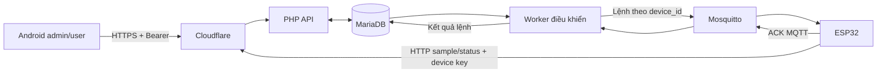
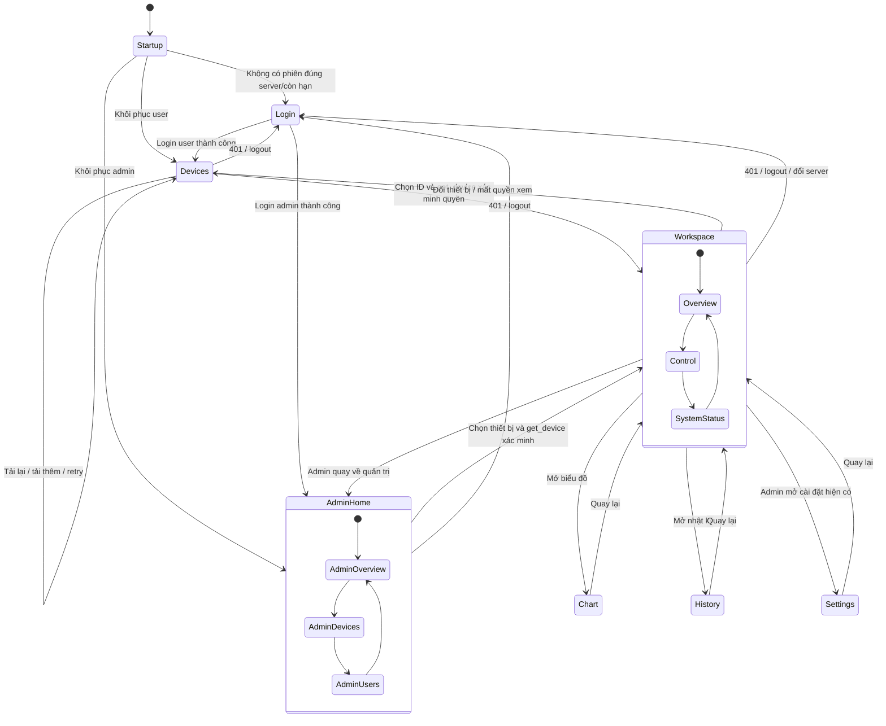

# Luồng xử lý Smart Pool v2

**Source kế tiếp 006:** [khóa HTTP chung + liên kết ID–MAC](shared-key-hardware.md). Database đã có migration cộng thêm, API kiểm tra cặp ID/MAC; firmware gửi MAC gốc HTTP/MQTT. Bản 006 chưa áp dụng Pi hoặc kiểm thử, không thay ghi nhận deploy 005 trước đây.

Cập nhật 18/11/2026 theo source hiện tại. Android đã cập nhật nền tảng phiên và UI quản trị
của [kế hoạch](android-api-v2-plan.md); source mới **chưa build/kiểm thử**.
Chi tiết chức năng còn chờ và checklist nằm trong
[README Android](../android-app/README_MQTT_ESP32.md).

Phần ESP/API/worker mới được mô tả tại [runtime 005](esp-api-mqtt-runtime.md): config HTTP + báo cáo áp dụng, giờ đo NVS, ACK/audit giao dịch và readiness HTTP/MQTT/worker. Bản này chưa build/test/triển khai; Android chưa sửa trong đợt này, checklist riêng ở tài liệu runtime.

## 1. Kiến trúc



Android không dùng credential ESP hoặc DB. Luồng app chính không publish MQTT
trực tiếp; MQTT kết nối worker với ESP bằng namespace theo thiết bị.
Worker chuyển lệnh bơm và theo dõi MQTT presence. ESP tự tải cấu hình bằng HTTP; worker không publish config/desired.

## 2. Phiên và chọn thiết bị



- Login trả user, token, expires_in và trang devices/cursor. Role chỉ admin/user.
- Nhớ đăng nhập lưu phiên private; không nhớ chỉ giữ trong process.
  Phiên còn gắn với URL API chuẩn hóa và user ID. Phiên legacy không đủ context
  không được tái sử dụng.
- Admin vào ba tab quản trị toàn hệ thống mà không cần selected device; user vào
  danh sách được cấp. Không tự chọn thiết bị đầu tiên. Chưa chọn thì không mở workspace.
- Tổng quan gốc là thống kê danh mục theo trang đã tải, ghi rõ “còn trang”, không
  tự xác nhận MQTT/ESP online. Workspace Tổng quan của cả hai role là một thiết bị.
- Context thiết bị chứa snapshot phiên và identity selection. Mỗi lần chọn lại
  tạo context khác, kể cả A → B → A. Callback context cũ bị bỏ.
- Rời màn hình đóng API client, hủy request/timer và ngừng chờ lệnh cục bộ.
  Không hủy giao dịch đã tới server, không tự gửi OFF.
- Đổi URL xóa phiên/context và yêu cầu login; token cũ không theo URL mới.
  API client không tự theo redirect HTTP.
- Logout bỏ phiên local và thử thu hồi token đúng server cũ; lỗi/offline có thông báo.

## 3. Quyền tài khoản và thiết bị

<a id="xac-thuc-va-ranh-gioi-quyen"></a>

```text
users ↔ device_users ↔ devices
        view/control/configure
```

Admin quản trị toàn hệ thống; user có thể thuộc nhiều thiết bị và nhiều user
cùng một thiết bị. `owner_user_id` là metadata, không thay membership.
Gỡ membership không xóa tài khoản/quyền trên thiết bị khác.

Backend kiểm tra quyền thật ở mỗi action. `get_device` tải lại quyền trên Main
định kỳ; mất view hoặc user không được xem thiết bị inactive thì về danh sách.
Admin vẫn xem được inactive, nhưng không control/configure.
`401` không phải `403`; xung đột `409` không được tự biến thành ghi thành công.

Giới hạn hiện tại: Settings vẫn admin-only. User có can_configure chưa có UI
lưu cấu hình; user xem thành viên bị backend chặn vì list_device_members vẫn
admin-only. Trang admin đã có đăng ký manual, active/inactive và thêm/sửa/gỡ
membership theo API. Tạo user/admin, khóa/mở và đặt lại mật khẩu ở tab Người dùng.
Gán quyền từ user chọn từng thiết bị và đọc membership trước khi sửa; không
suy ra quyền từ owner hoặc dựng danh sách “đã gán” khi API chưa có truy vấn đó.

Mã user_code tùy chỉnh/duy nhất, sửa hồ sơ/metadata, lưu trữ và khôi phục đang chờ
hợp đồng API/database. Khóa không phải lưu trữ; vô hiệu hóa không phải xóa hoặc
lệnh tắt relay. Không tự cấp membership khi tạo user/đăng ký thiết bị.

Firmware mới đọc serial MAC eFuse, tách khỏi Device ID và khóa HTTP. ID/key cấp qua AP local được lưu NVS; HTTP và MQTT lấy ID runtime, không cần header riêng cho mỗi bo. Chưa có liên kết serial trong database/API claim phần cứng hoặc BLE. Xem [hướng dẫn local và luồng Scan new device dành cho admin sau này](device-provisioning-local-and-ble.md). Không dùng địa chỉ MAC quét BLE thay serial được đọc tường minh.

## 4. Số đo, trạng thái và cấu hình

```mermaid
sequenceDiagram
    participant E as ESP32
    participant P as API
    participant D as MariaDB
    participant A as Android
    E->>P: upload_sample(device_id, sample_id, device key)
    P->>D: sensor_samples; chống trùng ID trong thiết bị
    E->>P: report_status(boot_id, state_sequence)
    P->>D: device_status của thiết bị
    A->>P: Bearer + get_device/get_config/get_status
    P-->>A: Quyền, cấu hình và báo cáo đúng thiết bị
    A->>P: get_history(device_id)
    P-->>A: Lịch sử của thiết bị
```

`latest_measured_sample` khác `last_received_sample`. Không biết giờ đo thì
measured_at_ms=null, không đổi giờ nhận thành giờ đo. Source Main hiện còn dùng
mẫu nhận cuối và mốc kiểm tra trên điện thoại; hoàn thiện cách trình bày thời gian,
độ cũ mẫu, bộ lọc time_basis/cursor thuộc giai đoạn 2.

Main đọc `get_config` trước khi mở điều khiển, cache hiệu chuẩn/ngưỡng/interlock
theo server + user ID + device ID. Không nhập preferences legacy toàn cục.
Backend có update_config với expected_revision và trả delivery=stored_only;
biểu mẫu lưu v2 trên app còn cần hoàn thiện. Firmware runtime 005 đã có đường tải/lưu cấu hình và báo config_apply/reported_config_revision qua HTTP; xem giới hạn và checklist ở tài liệu runtime.

Lưu đồ Hệ thống phản ánh app → API, độ mới báo cáo HTTP, cờ cảm biến và relay
do ESP báo. is_recent_report không chứng minh MQTT online hay motor đang chạy.
Không có báo cáo là chưa xác minh, không tự đồng nghĩa OFF.

## 5. Điều khiển

```mermaid
sequenceDiagram
    participant A as Android
    participant P as API
    participant D as MariaDB
    participant W as Worker
    participant M as MQTT
    participant E as ESP32
    A->>P: request_control(device_id, request_id, target, enabled)
    P->>D: Kiểm tra quyền, lưu pending + TTL + audit
    P-->>A: Đã ghi nhận; not_published_by_api
    W->>D: Đọc lệnh còn hạn, kiểm tra lại quyền và báo cáo
    W->>M: smartpool/devices/ID/cmd/pump
    M->>E: Lệnh không retained
    E->>M: smartpool/devices/ID/ack/command
    M->>W: applied / rejected
    W->>D: Cập nhật kết quả
    A->>P: get_command + get_status
    P-->>A: Kết quả lệnh và trạng thái relay được báo
```

Worker có code và container có thể đang chạy, nhưng cần người dùng kiểm tra đầu cuối.
Pending không phải bơm đã bật. Applied là ESP xác nhận, không phải phản hồi cơ khí.
Expired/rejected/cancelled không được hiển thị là thành công. Đóng app không hủy
lệnh server; API chưa có cancel_command.

## 6. Nhật ký, lưu trữ và các phần tạm khóa

- Server lưu audit với actor/source backend, client hoặc device. Client_reported
  không nâng thành xác nhận backend/phần cứng.
- Màn nhật ký chỉ lấy list_activity của context hiện tại, tối đa trang 100 sự kiện.
  Không trộn hoặc đồng bộ SQLite legacy; typed outbox/phân trang còn chờ.
- Preferences phiên/thiết bị và SQLite bị loại khỏi backup/transfer. Không lưu
  password/token/device key trong nhật ký; Gradle không nhúng credential MQTT.
- Giám sát nền tạm dừng: Main không tự start; service nhận start tự dừng và xóa
  notification cũ. Chờ cơ chế admin bật/tắt và context giám sát v2.
- Các nút MQTT/config/hiệu chuẩn legacy bị khóa; không dùng topic chung làm fallback.
- BLE chưa triển khai. Web/AP cục bộ của ESP không được gọi là BLE provisioning;
  đổi API URL của điện thoại không tự đổi NVS hoặc Wi-Fi của ESP.

Các bảng chính: users, user_sessions, devices, device_users, device_configs,
device_credentials, device_status, sensor_samples, device_commands, activity_logs.
Xem [schema/API v2](database-v2.md) và [triển khai Pi](../deploy/raspberry-pi-v2/README.md).
