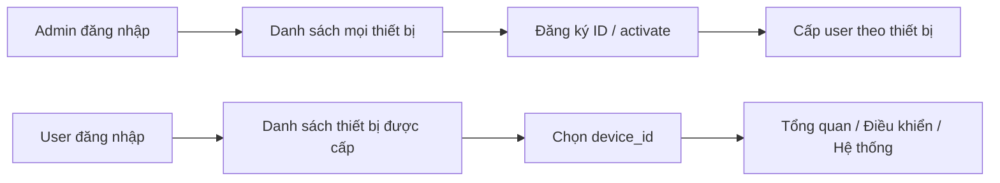
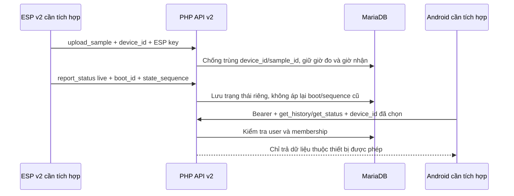

# Luồng xử lý Smart Pool

Tài liệu hiện tại mô tả **database/API v2 và hợp đồng tích hợp dự kiến**, không khẳng định app/ESP đã chuyển đổi. Chi tiết schema, reset và request nằm trong [database-v2.md](database-v2.md).

## Đăng nhập và chọn thiết bị

API login trả user, session và trang danh sách thiết bị. Admin quản lý registry/membership; user thường có role `user`, không còn role `guest` trong DB mới. API kiểm tra membership và active, không chỉ dựa UI. Android cần thêm màn chọn thiết bị, giữ selected device_id và gửi đúng context trong mọi request.

## Lưu mẫu và trạng thái

Mẫu không biết giờ đo để null, không suy từ giờ nhận. History có time_basis received/measured, khoảng thời gian và cursor. Mẫu gửi bù không ghi đè relay status. ESP hiện tại chưa gửi hợp đồng này; cần đổi payload, credential và layout hàng đợi NVS trong bước firmware tiếp theo.

## Cấu hình và điều khiển

User có configure → update_config với expected_revision → server lưu revision mới và audit. Đây là cấu hình mong muốn, không phải xác nhận ESP áp dụng. ESP v2 có thể đọc get_device_config và báo reported_config_revision; worker MQTT/BLE chưa làm.

User có control → request_control → server lưu lệnh theo device với TTL và audit, trả not_published_by_api. ACK cần credential đúng thiết bị. API chưa phát lệnh ra Mosquitto; app/firmware hiện vẫn dùng topic chung và chưa tích hợp đường lệnh mới.

## BLE và Wi-Fi

BLE sau này giúp admin đọc ID khi đăng ký và giúp user có quyền cấu hình gửi SSID/password trực tiếp khi ở gần ESP. Cách đó có thể phục hồi khi ESP offline. Database không lưu Wi-Fi password; registration_source=ble chỉ là metadata, chưa phải xác minh scan/khoảng cách hay bằng chứng sở hữu.

## Nhật ký và quyền

Backend tự ghi audit khi giao dịch quản trị/config/lệnh commit. Nhật ký client luôn source=client/client_reported; báo cáo ESP source=device/reported. Thành viên có view đọc nhật ký của cả thiết bị, gồm tác nhân thực hiện; không đọc nhật ký thiết bị khác. Gỡ user chỉ gỡ dòng device_users.

MQTT vẫn dùng account/topic chung nên revoke membership không tự chặn người giữ credential MQTT. Trước khi tích hợp nhiều ESP, phải đổi namespace topic và ACL/credential hoặc thêm backend kiểm tra quyền trước publish. Không mở rộng nhiều thiết bị trên topic chung hiện tại.
