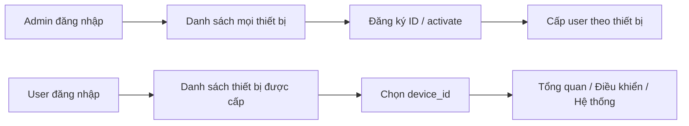
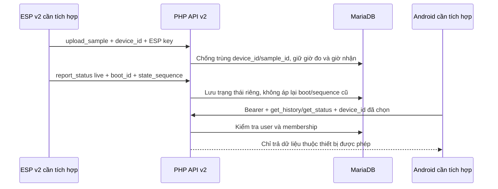
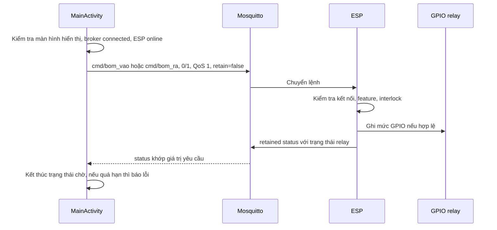
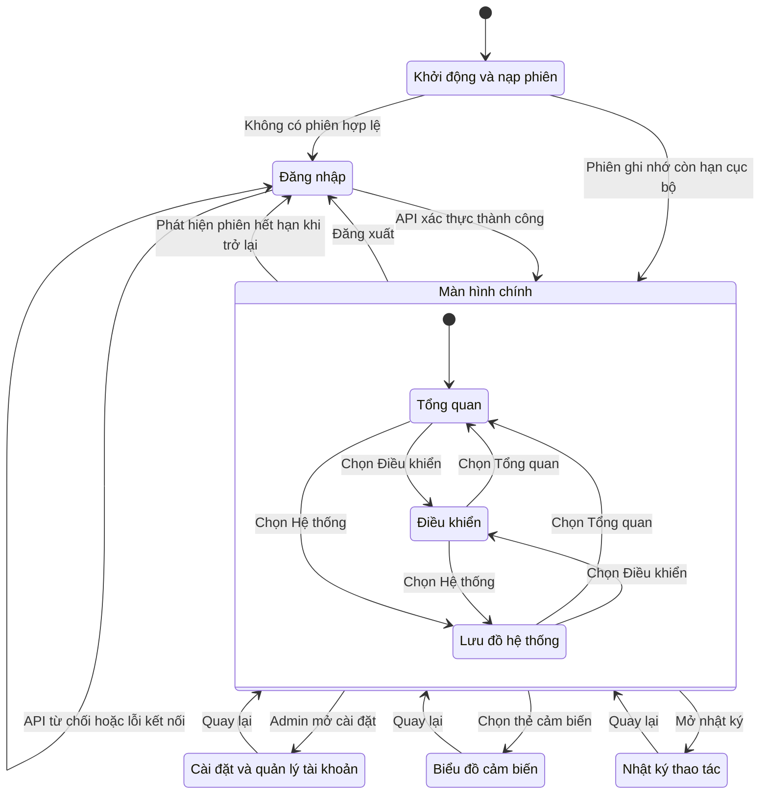
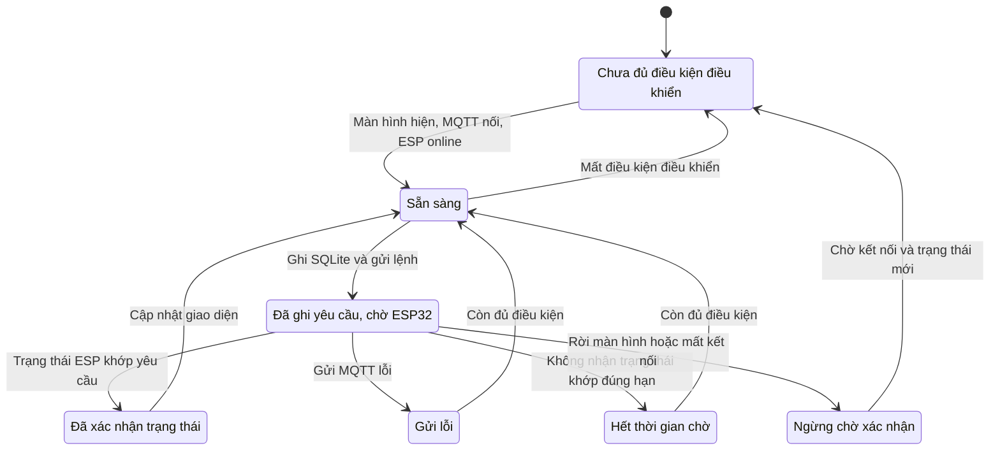

# Luồng xử lý Smart Pool

Tài liệu hiện tại mô tả **database/API v2 và hợp đồng tích hợp dự kiến**, không khẳng định app/ESP đã chuyển đổi. Chi tiết schema, reset và request nằm trong [database-v2.md](database-v2.md).

## Đăng nhập và chọn thiết bị

API login trả user, session và trang danh sách thiết bị. Admin quản lý registry/membership; user thường có role `user`, không còn role `guest` trong DB mới. API kiểm tra membership và active, không chỉ dựa UI. Android cần thêm màn chọn thiết bị, giữ selected device_id và gửi đúng context trong mọi request.

## Lưu mẫu và trạng thái

Mẫu không biết giờ đo để null, không suy từ giờ nhận. History có time_basis received/measured, khoảng thời gian và cursor. Mẫu gửi bù không ghi đè relay status. ESP hiện tại chưa gửi hợp đồng này; cần đổi payload, credential và layout hàng đợi NVS trong bước firmware tiếp theo.

## Cấu hình và điều khiển

User có configure → update_config với expected_revision → server lưu revision mới và audit. Đây là cấu hình mong muốn, không phải xác nhận ESP áp dụng. ESP v2 có thể đọc get_device_config và báo reported_config_revision; worker MQTT/BLE chưa làm.

User có control → request_control → server lưu lệnh theo device với TTL và audit, trả not_published_by_api. ACK cần credential đúng thiết bị. API chưa phát lệnh ra Mosquitto; app/firmware hiện vẫn dùng topic chung và chưa tích hợp đường lệnh mới.

## BLE và Wi-Fi
MainActivity hỏi GET API mặc định mỗi 3 giây lúc đang hiển thị, không lấy cảm biến trực tiếp từ telemetry MQTT; MQTT status cập nhật trạng thái relay và trạng thái bật/tắt cảm biến. Công tắc trong mục Điều khiển gửi lệnh bật/tắt đo qua MQTT, chờ ESP xác nhận; cảm biến đã tắt không hiển thị số đo cũ hoặc tạo cảnh báo trên màn hình. `SensorChartActivity` gọi `?history=1&limit=100` (API chấp nhận 1..500), trả các mẫu gần nhất theo thứ tự thời gian server. `PoolMonitorService` dùng kết nối MQTT riêng subscribe status và telemetry để đánh giá cảnh báo/thông báo nền khi service hoạt động; nhận trạng thái tắt cảm biến nhiệt độ sẽ hủy thông báo nhiệt độ và ngừng đánh giá đến khi bật lại.

BLE sau này giúp admin đọc ID khi đăng ký và giúp user có quyền cấu hình gửi SSID/password trực tiếp khi ở gần ESP. Cách đó có thể phục hồi khi ESP offline. Database không lưu Wi-Fi password; registration_source=ble chỉ là metadata, chưa phải xác minh scan/khoảng cách hay bằng chứng sở hữu.

## Nhật ký và quyền

Backend tự ghi audit khi giao dịch quản trị/config/lệnh commit. Nhật ký client luôn source=client/client_reported; báo cáo ESP source=device/reported. Thành viên có view đọc nhật ký của cả thiết bị, gồm tác nhân thực hiện; không đọc nhật ký thiết bị khác. Gỡ user chỉ gỡ dòng device_users.

Broker đã dùng account/ACL theo thiết bị, xem [MQTT v2](mqtt-v2.md). App/firmware cũ chưa được cập nhật; bridge worker chưa triển khai. Gỡ membership chưa tự thu hồi MQTT account ESP; operator quản lý bằng mqtt-admin.py. Không cấp bridge credential cho app user.
MQTT vẫn dùng account/topic chung nên revoke membership không tự chặn người giữ credential MQTT. Trước khi tích hợp nhiều ESP, phải đổi namespace topic và ACL/credential hoặc thêm backend kiểm tra quyền trước publish. Không mở rộng nhiều thiết bị trên topic chung hiện tại.

`MqttControlGate` yêu cầu activity đang hiển thị, broker đã nối và ESP báo online. Sau reconnect, app đợi status ESP trước khi cho điều khiển. Chỉ publish thành công chưa xác nhận ESP đã thực thi; ACK cấu hình và xác nhận bơm là hai cơ chế khác nhau.

Lệnh bơm chỉ nhận đúng một byte `0`/`1`. Firmware bỏ lệnh ON retained để tránh bật lại từ lệnh cũ. Mỗi topic chỉ thay đổi một kênh; interlock nếu bật sẽ từ chối hai bơm cùng ON. Interlock mặc định firmware OFF, app mặc định ON và có thể đồng bộ qua cấu hình thresholds; phải xem giá trị ESP đang báo. Điều khiển tay làm tạm dừng tự động hóa của kênh đó trong phiên boot.

Trạng thái `bom_vao_control`/`bom_ra_control` xác nhận trạng thái mà firmware điều khiển GPIO; chưa có cảm biến phản hồi motor/tiếp điểm. Việc rời MainActivity dừng polling và khóa thao tác UI, không có nghĩa tự gửi OFF cho mọi bơm.

## 6. Cấu hình và tự động hóa

Settings dùng các gói config có action, timestamp và `req_id` để ESP kiểm tra, lưu NVS rồi phát `smartpool/ack` và status. Kiểm tra timestamp theo từng nhóm giúp từ chối cấu hình cũ. Với thay đổi Wi-Fi, ESP chờ ACK QoS 1 tối đa 3 giây trước khi đổi mạng. Broker/credential có thể đổi qua web local; đổi API trong app không tự thay broker của ESP.

| Topic | Chiều | Nội dung / retained |
| --- | --- | --- |
| `smartpool/status` | ESP → app | Online, relay, feature, thresholds, automation, IP LAN, API URL; retained |
| `smartpool/telemetry` | ESP → app/service | Mẫu đo và trạng thái; không retained |
| `smartpool/cmd/bom_vao`, `smartpool/cmd/bom_ra` | App → ESP | 0/1; không retained |
| `smartpool/cmd/temperature_enabled`, `smartpool/cmd/water_level_enabled` | Client → ESP | Bật/tắt đọc cảm biến runtime |
| `smartpool/config/thresholds` | App → ESP | Nhiệt độ, ngưỡng ADC nước, interlock; retained |
| `smartpool/config/device`, `smartpool/config/wifi`, `smartpool/config/http` | App → ESP | Thiết bị, Wi-Fi, API/polling metadata; cấu hình retained |
| `smartpool/config` | App → ESP | Sync All, các nhóm cấu hình; retained |
| `smartpool/config/automation` | App → ESP | Quy tắc một bơm, bắt buộc không retained |
| `smartpool/ack` | ESP → app | `req_id`, action, SUCCESS/ERROR; không retained |
| `smartpool/cmd/wifi_scan`, `smartpool/wifi/scan_result` | App ↔ ESP | Yêu cầu quét và kết quả; không retained |

Quy tắc tự động hóa nằm trên ESP, được lưu trong NVS; không có scheduler bơm trên Pi. Task chạy mỗi 250 ms, dùng mẫu còn mới: tối đa khoảng `2 × chu kỳ lấy mẫu + 2 giây`. Điều kiện khởi động đã bật kết hợp theo OR; dừng theo thời lượng hoặc khi một điều kiện ngưỡng dừng đạt, kèm thời gian tối đa. Firmware kiểm tra dữ liệu cảm biến cần thiết, interlock và trạng thái relay. Sau một lượt hoàn tất/timeout, phải thoát điều kiện khởi động rồi mới được kích hoạt lại, tránh lặp ngay trên cùng một giá trị.

App cho nhập mực nước bằng cm, ánh xạ về ADC trước khi gửi. ESP và DB vẫn lưu giá trị ADC; không diễn giải ADC là cm trực tiếp. Cấu hình hiệu chuẩn app không phải một cột đo cm của database.

## 7. Xác thực và ranh giới quyền

1. Splash gọi `UserSession.restore()`: nếu có phiên ghi nhớ chưa hết hạn theo đồng hồ thiết bị thì mở MainActivity, nếu không thì mở LoginActivity. Restore local không gọi server để xác minh token ngay.
2. Login gửi POST `action: login` cùng username/password/remember_me tới API. PHP kiểm tra tài khoản đang hoạt động và `password_verify()`, tạo token ngẫu nhiên, lưu hash SHA-256 của token rồi trả username, role, token và expires_in.
3. Ghi nhớ: server cấp 30 ngày và app lưu token/role/expiry vào SharedPreferences riêng tư. Không ghi nhớ: phiên server 12 giờ, thông tin phiên chỉ giữ trong bộ nhớ tiến trình app.
4. Các thao tác quản lý tài khoản và nhật ký gửi `Authorization: Bearer TOKEN`. PHP kiểm tra token hash, hạn phiên, tài khoản active; quản lý tài khoản cần quyền admin. Logout gọi API để xóa token phía server và xóa phiên local.
5. Admin có cấu hình/quản lý guest và tạo thêm admin. Tài khoản admin hiện có không sửa/xóa trong tab quản lý. Guest có giao diện xem và bật/tắt cảm biến, lịch sử và điều khiển hai bơm.
6. API nhật ký lấy người thực hiện từ phiên đăng nhập, không tin username gửi lên. Guest chỉ đọc nhật ký của mình, admin đọc mọi tài khoản. Ẩn nút trong app không thay thế kiểm tra quyền tại server/broker.

| Cơ chế | Bảo vệ hiện có | Giới hạn |
| --- | --- | --- |
| App/API session | Login, API quản lý tài khoản và nhật ký | GET số đo/history, POST telemetry và endpoint command cũ chưa yêu cầu token |
| MQTT | Password + ACL cho `esp32` và `android` | Chưa tách MQTT credential theo user admin/guest; user `android` có quyền ghi config/cmd |
| MariaDB | User/password trong mạng Docker | App/ESP không dùng credential DB |
| Web ESP | Wi-Fi AP có mật khẩu; truy cập LAN | Endpoint web local chưa dùng token đăng nhập app |

Cloudflare cung cấp đường HTTPS/WSS, không tự thêm xác thực cho API hoặc web ESP. Mật khẩu triển khai lấy từ `.env`/file credentials riêng trên Pi, không chép vào README. `mqtt_credentials.h` hiện là file được theo dõi trong Git; cần kiểm tra diff trước khi chia sẻ repository chứa credential.

## 8. Mất kết nối và dữ liệu cũ

| Tình huống | Hành vi hiện tại |
| --- | --- |
| ESP mất Wi-Fi/MQTT | Dừng kênh bơm thuộc điều khiển từ xa; giữ cách xử lý riêng cho local/automation; Last Will báo offline khi broker phát hiện mất kết nối |
| Bơm local hoặc automation | Được đánh dấu điều khiển local, có thể tiếp tục khi broker không có; automation vẫn phải đáp ứng điều kiện cảm biến/dừng |
| API không phản hồi | ESP lưu hàng đợi và gửi bù; MQTT có thể còn hoạt động |
| MQTT mất nhưng API còn | App có thể đọc DB nhưng không đủ điều kiện điều khiển từ xa |
| Pi khởi động lại | Volume giữ DB/MQTT; dịch vụ tự chạy nếu chưa bị stop chủ động; Quick Tunnel có thể đổi URL |
| Đổi URL Quick Tunnel | Cập nhật endpoint ở cả ESP và Android; thay URL source không tự sửa NVS/SharedPreferences |
| Đọc lại DB khi ESP offline | Có thể thấy mẫu cuối cùng; HTTP 200 không phải heartbeat ESP |
| Khóa user / thu hồi token | API quản lý tài khoản từ chối token; không tự thu hồi credential MQTT dùng chung hoặc xóa phiên đã restore khỏi UI ngay lập tức |

Backend vẫn giữ `pool_commands`, GET `?commands=1` và POST `command` để tương thích. **Firmware hiện tại không polling lệnh HTTP**. API trả accepted cho command cũ không chứng minh ESP sẽ thực thi; healthcheck dùng `?commands=1` chỉ kiểm tra API/DB.

## 9. Bảng lưu trữ và điểm kiểm tra code

| Nơi lưu | Nội dung |
| --- | --- |
| ESP NVS | Wi-Fi, endpoint/credential MQTT, API, cấu hình đã lưu, quy tắc và hàng đợi telemetry |
| `pool_status` | Bản ghi trạng thái id=1; GET bổ sung ADC nước gần nhất từ history |
| `pool_history` | Mẫu có sample_id duy nhất, nhiệt độ/ADC nullable, received_at |
| `pool_activity_log` | Sự kiện app với event_id duy nhất, request_id, tài khoản, thiết bị, thao tác, kết quả và thời gian |
| `pool_users` | Username, hash mật khẩu, admin/guest, active |
| `pool_user_sessions` | Hash token, user, hạn phiên |
| `pool_commands` | Revision/lệnh HTTP cũ; không phải kênh điều khiển firmware hiện tại |
| Volume Docker | Database, MQTT auth và persistence |
| Android SharedPreferences | AppConfig, tab Settings/biểu đồ và phiên khi chọn ghi nhớ; endpoint đã lưu ưu tiên mặc định |
| Android SQLite | Nhật ký thao tác và hàng đợi đồng bộ theo tên tài khoản/URL API |

Muốn thay luồng, bắt đầu từ `main.c` (lấy mẫu), `pool_network.c` (network/ownership/config), `pool_mqtt_protocol.c` (kiểm tra giao thức), `pump_auto.c` (quy tắc), `pool_api.php` (API/SQL), `MainActivity.java` (HTTP/UI/lệnh), `SettingsActivity.java` (config), `PoolMonitorService.java` (cảnh báo) và `UserSession.java` (phiên local).

## 10. Trạng thái ứng dụng điện thoại

### Điều hướng và phiên đăng nhập

Guest không vào Settings. Rời màn hình chính dừng polling HTTP và ngừng chờ lệnh trên màn hình; không đồng nghĩa dừng dịch vụ giám sát MQTT hoặc gửi OFF cho bơm. Khi quay lại, app kết nối/nhận lại trạng thái thiết bị trước khi mở điều khiển.

Ba mục Tổng quan/Điều khiển/Hệ thống nằm trong cùng MainActivity với thanh điều hướng dưới cố định: chuyển mục không dừng polling hoặc kết nối MQTT. Nhật ký và Cài đặt mở từ thanh trên; Cài đặt vẫn chỉ dành cho admin. Các nhóm biểu mẫu Thiết bị mở/thu gọn mà không tự gửi dữ liệu. Lưu đồ lấy trạng thái linh kiện/quy tắc từ status ESP, không suy ra từ cấu hình cục bộ. API và MQTT là hai nhánh độc lập; MariaDB chỉ được xác nhận gián tiếp qua truy vấn API hợp lệ. Không liên lạc được thiết bị thì trạng thái phần cứng là chưa rõ, không phải tắt. Thời gian hiển thị là lúc nhận phản hồi, status MQTT có thể là retained.

### Vòng đời yêu cầu điều khiển bơm và cảm biến

Cảm biến còn yêu cầu firmware báo hỗ trợ tính năng. Xác nhận là trạng thái do ESP32 báo, không phải cảm biến phản hồi cơ khí. Cấu hình trong Settings dùng ACK khớp `req_id` và `action`; không dùng broker PUBACK làm xác nhận đã lưu ESP32. Khóa liên động trên màn hình chính chỉ ghi kết quả gửi tới broker.

### Nhật ký và khôi phục

App ghi các sự kiện bất biến vào SQLite: yêu cầu và kết quả là hai sự kiện cùng `request_id`. Mỗi sự kiện có `event_id` riêng; API chèn lại cùng ID không tạo bản sao. Đồng bộ theo từng lô tối đa 20 sự kiện, chỉ đánh dấu đã gửi khi API xác nhận. Mất mạng giữ bản cục bộ; không buộc API phải online để gửi điều khiển MQTT.

Sự kiện gắn với tên tài khoản/URL API lúc phát sinh. Nếu đổi tên tài khoản hoặc URL, hàng đợi cũ không tự chuyển sang danh tính/máy chủ mới. Màn hình nhật ký hợp nhất bản cục bộ và máy chủ theo `event_id`, hiển thị tối đa 100 mục. Thời gian sự kiện theo đồng hồ điện thoại, `received_at` trong bảng nhật ký theo máy chủ.

Đây là nhật ký do app báo cáo, không ghi nhận đầy đủ thao tác từ web ESP hoặc mọi client MQTT khác. Không lưu mật khẩu, token hoặc payload cấu hình vào sự kiện. Tiến trình bị dừng đột ngột có thể để lại yêu cầu chưa có kết quả; app không tự gán thành công hoặc gửi lại lệnh bơm.

App giữ cấu hình đã lưu qua SharedPreferences, khôi phục tab Settings và lựa chọn cảm biến biểu đồ. Trạng thái relay/cảm biến lấy lại từ ESP32, không phát lại lệnh ON đã dùng trước đó. Trục X biểu đồ dùng `received_at_ms` từ MariaDB, đúng khoảng thời gian và theo múi giờ điện thoại; timestamp này là thời điểm tiếp nhận, không phải thời điểm đo offline.
