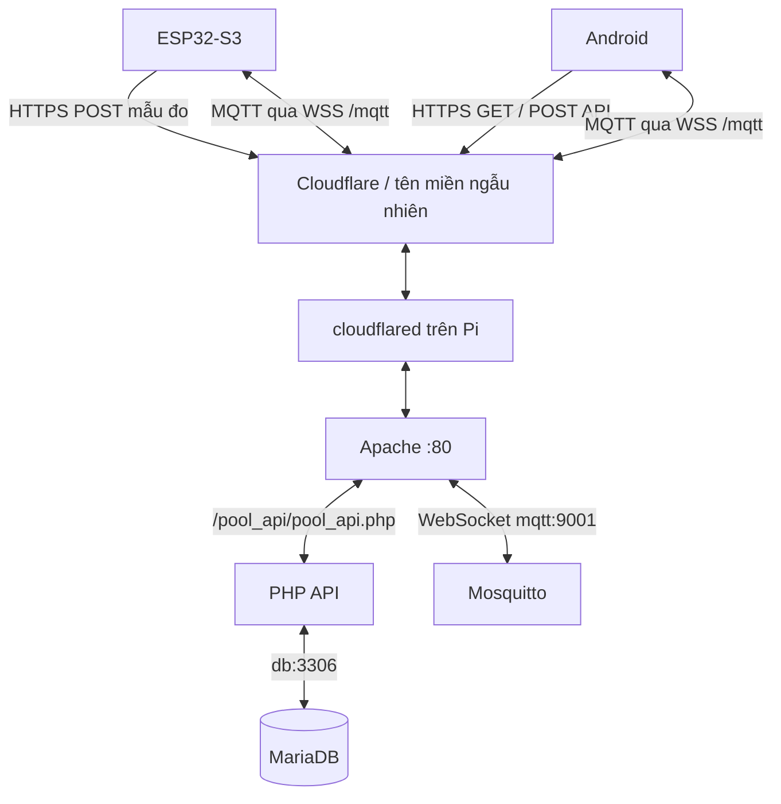
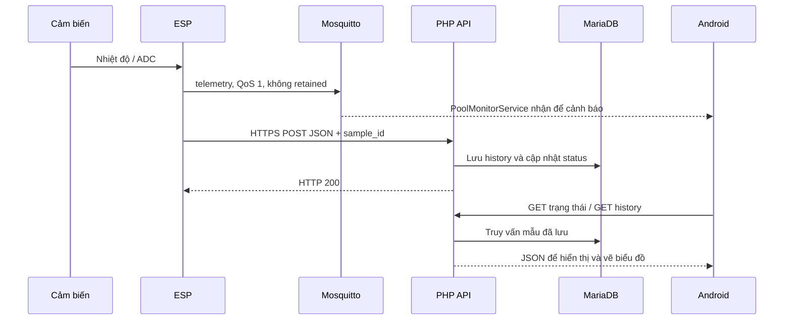

# Luồng xử lý toàn hệ thống Smart Pool

Tài liệu đối chiếu với source ngày 17/11/2026. Đây là mô tả code và cấu hình trong repository, không phải kết quả kiểm tra trực tiếp mọi thiết bị tại thời điểm đọc. Bắt đầu vận hành tại [README chính](../README.md); các lệnh cài đặt nằm trong [hướng dẫn Pi](../deploy/raspberry-pi/README.md).

## 1. Vai trò và đường kết nối

| Thành phần | Trách nhiệm | Source chính |
| --- | --- | --- |
| ESP32-S3 | Đọc DS18B20/ADC, GPIO relay, tự động hóa, web local, upload và lưu hàng đợi | `esp-firmware/main/main.c`, `pool_network.c`, `pump_auto.c`, `wifi_setup.c` |
| Mosquitto trên Pi | Xác thực MQTT, ACL, chuyển tiếp topic, giữ retained status/config | `deploy/raspberry-pi/mosquitto.conf`, `mosquitto.acl` |
| PHP/Apache trên Pi | API JSON, tài khoản/phiên, ghi/đọc MariaDB; proxy WebSocket | `backend/pool_api.php`, `database.php`, `deploy/raspberry-pi/apache-smartpool.conf` |
| MariaDB trên Pi | Trạng thái gần nhất, lịch sử, tài khoản, phiên và bảng lệnh cũ | `backend/pool_db.sql` |
| cloudflared | Mở kết nối tunnel từ Pi ra Cloudflare; chuyển HTTPS/WSS về Apache | `deploy/raspberry-pi/compose.cloudflare.yaml` |
| Android | Đăng nhập, hiển thị HTTP, lệnh/status MQTT, cấu hình và thông báo | `android-app/app/src/main/java/com/buiducluan23011767/ck/` |



HTTPS/WSS kết thúc TLS tại Cloudflare; đoạn nội bộ Docker dùng HTTP/WebSocket. MQTT WSS vẫn là giao thức MQTT với username/password và ACL, không phải REST. API và MQTT chung domain nhưng khác đường dẫn.

Trong LAN có thể gọi HTTP `http://192.168.60.87/pool_api/pool_api.php` hoặc MQTT TCP: ESP dùng `mqtt://192.168.60.87:1883`, Android dùng `tcp://192.168.60.87:1883`. MariaDB không có cổng publish ra host trong Compose; truy cập bằng API hoặc công cụ trong container, không dùng Quick Tunnel để kết nối SQL trực tiếp.

## 2. Pi khởi động và xuất endpoint

1. `pool.sh up` cài/kiểm tra Docker, gọi `deploy.sh` rồi `cloudflare.sh start`.
2. MariaDB khởi tạo schema khi volume còn trống; API chờ DB healthy. `mqtt-init` tạo file mật khẩu từ `.env`, sau đó kết thúc; Mosquitto chờ init thành công.
3. Smoke test kiểm tra API và MQTT. cloudflared Quick Tunnel chuyển tiếp về `http://api:80`; Apache đưa `/mqtt` tới Mosquitto `9001` và PHP xử lý đường dẫn API.
4. `smartpool-cloudflare-endpoints.service` chạy exporter `cloudflare-endpoints.py`, đọc URL từ log container, kiểm tra readiness và ghi file `~/smartpool-endpoints.txt` mỗi 10 giây. File phân biệt lần khởi động container, không giữ URL online của phiên cũ khi phát hiện offline.
5. `db`, `api`, `mqtt`, `cloudflare` có `restart: unless-stopped`. Docker và exporter được cấu hình chạy sau reboot; `pool.sh stop` dừng chủ động, cần `up` để bật lại.

| Khóa file endpoint | Dùng ở đâu |
| --- | --- |
| `status` | Kiểm tra online/offline trước khi dùng URL |
| `api_url` | Địa chỉ gốc HTTPS |
| `http_api_url`, `android_http_api_url` | API đầy đủ `/pool_api/pool_api.php`, cho ESP/Android/Postman |
| `mqtt_wss_uri` | URI `wss://DOMAIN/mqtt`, cho ESP/Android/MQTTX |

Quick Tunnel không dùng token. URL có thể đổi khi tiến trình khởi động lại; exporter chỉ cập nhật file trên Pi, chưa có cơ chế discovery cập nhật URL tự động cho ESP/app. Phải sửa cả HTTP và MQTT trên các client.

## 3. ESP khởi động

1. `app_main()` khởi tạo relay, ADC và `pool_network_init()`. Relay được giữ OFF trong lúc nạp cấu hình; bản `sdkconfig` hiện chọn hai relay OFF khi boot.
2. ESP nạp Wi-Fi, endpoint, cấu hình MQTT và quy tắc từ NVS. Cấu hình kết nối đã lưu có ưu tiên hơn giá trị biên dịch. MQTT credential ban đầu lấy từ `main/mqtt_credentials.h`.
3. Web local/AP `SmartPool-Setup` được cung cấp để cài Wi-Fi, API, MQTT và điều khiển tại chỗ. AP vẫn tồn tại khi STA nối router; truy cập bằng `192.168.4.1` hoặc IP LAN của ESP. Chuyển chế độ router/lưu Wi-Fi mới dừng cả hai bơm trước khi đổi kết nối.
4. Khi có Wi-Fi, ESP đồng bộ giờ qua SNTP để dùng TLS. HTTP và MQTT chạy độc lập; HTTP lỗi không đồng nghĩa MQTT lỗi.
5. MQTT kết nối bằng user `esp32`, subscribe các topic cmd/config, phát retained status và yêu cầu một mẫu đo. ESP đăng ký Last Will `online:0` để broker thông báo mất kết nối.
6. Vòng đo tìm DS18B20 và đọc ADC. Hiện bật cả hai cảm biến: GPIO9 cho nhiệt độ, GPIO10 cho mực nước; relay GPIO15/16 active HIGH. Chỉ số runtime không bật được phần cứng đã bị tắt khi build.

## 4. Mẫu đo → lưu Pi → hiển thị Android



Vòng đo kiểm tra mỗi giây nhưng chỉ lấy mẫu theo khoảng: **60 giây khi hai bơm tắt, 5 giây khi có bơm chạy**; yêu cầu lấy mẫu từ sự kiện có thể làm đo sớm hơn. Sau đó `telemetry_task` gán `sample_id` 16 ký tự hex và xử lý hai đầu ra.

| Trường | Ý nghĩa |
| --- | --- |
| `sample_id` | ID ghép nonce của phiên boot và bộ đếm; giữ nguyên khi gửi bù |
| `nhiet_do` | Nhiệt độ °C khi đo được; HTTP bỏ trường nếu thiếu, MQTT có thể trả null |
| `muc_nuoc_raw` | ADC 0..4095; app ánh xạ sang cm theo hiệu chuẩn |
| `muc_nuoc` HTTP | Hợp đồng nhị phân: 0 thấp / 1 bình thường theo ngưỡng firmware |
| `muc_nuoc` MQTT | 0 dưới ngưỡng / 1 trong khoảng / 2 trên ngưỡng đã lưu |
| `bom_control`, `van_control` HTTP | Trạng thái điều khiển relay, không phải phản hồi vật lý |

Nếu gửi HTTP lỗi hoặc còn mẫu cũ chờ gửi, mẫu được xếp vào hàng đợi NVS bền vững tối đa **128 mẫu**. Có mạng thì gửi lại theo thứ tự, tối đa 4 mẫu mỗi lượt flush; chỉ bỏ khỏi hàng đợi sau khi gửi thành công. Đầy hàng đợi thì bỏ mẫu cũ nhất. Khoảng lưu tối đa lý thuyết là 128 phút khi lấy mẫu 60 giây hoặc 10 phút 40 giây khi lấy mẫu 5 giây; sự kiện trạng thái cũng có thể chiếm chỗ nên thực tế ngắn hơn.

API dùng `INSERT IGNORE` theo `sample_id` để retry không thêm history trùng. Sự kiện chỉ có trạng thái không tạo dòng history toàn null. `received_at` là lúc MariaDB nhận dữ liệu; hiện không lưu thời điểm đo offline riêng. Trong lúc gửi bù, số đo API có thể đi qua các mẫu cũ trước khi bắt kịp hiện tại.

MainActivity hỏi GET API mặc định mỗi 3 giây lúc đang hiển thị, không lấy cảm biến trực tiếp từ telemetry MQTT; MQTT status cập nhật trạng thái relay. `SensorChartActivity` gọi `?history=1&limit=100` (API chấp nhận 1..500), trả các mẫu gần nhất theo thứ tự thời gian server. `PoolMonitorService` dùng kết nối MQTT riêng subscribe telemetry để đánh giá cảnh báo/thông báo nền khi service hoạt động.

GET API thành công xác nhận đọc được backend, không xác nhận mẫu vừa được đo hoặc ESP đang online. Không dùng `is_app_active` trong DB làm bằng chứng ESP online.

Trường `ph` còn trong schema/API để tương thích, nhưng firmware hiện không có cảm biến pH hoặc luồng đo pH. Không diễn giải giá trị mặc định của trường này thành kết quả đo thực tế.

## 5. App → lệnh bơm → ESP → xác nhận

```mermaid
sequenceDiagram
    participant A as MainActivity
    participant M as Mosquitto
    participant E as ESP
    participant R as GPIO relay
    A->>A: Kiểm tra màn hình hiển thị, broker connected, ESP online
    A->>M: cmd/bom_vao hoặc cmd/bom_ra, 0/1, QoS 1, retain=false
    M->>E: Chuyển lệnh
    E->>E: Kiểm tra kết nối, feature, interlock
    E->>R: Ghi mức GPIO nếu hợp lệ
    E->>M: retained status với trạng thái relay
    M-->>A: status khớp giá trị yêu cầu
    A->>A: Kết thúc trạng thái chờ; nếu quá hạn thì báo lỗi
```

`MqttControlGate` yêu cầu activity đang hiển thị, broker đã nối và ESP báo online. Sau reconnect, app đợi status ESP trước khi cho điều khiển. Chỉ publish thành công chưa xác nhận ESP đã thực thi; ACK cấu hình và xác nhận bơm là hai cơ chế khác nhau.

Lệnh bơm chỉ nhận đúng một byte `0`/`1`. Firmware bỏ lệnh ON retained để tránh bật lại từ lệnh cũ. Mỗi topic chỉ thay đổi một kênh; interlock nếu bật sẽ từ chối hai bơm cùng ON. Interlock mặc định firmware OFF, app mặc định ON và có thể đồng bộ qua cấu hình thresholds; phải xem giá trị ESP đang báo. Điều khiển tay làm tạm dừng tự động hóa của kênh đó trong phiên boot.

Trạng thái `bom_vao_control`/`bom_ra_control` xác nhận trạng thái mà firmware điều khiển GPIO; chưa có cảm biến phản hồi motor/tiếp điểm. Việc rời MainActivity dừng polling và khóa thao tác UI, không có nghĩa tự gửi OFF cho mọi bơm.

## 6. Cấu hình và tự động hóa

Settings dùng các gói config có action, timestamp và `req_id` để ESP kiểm tra, lưu NVS rồi phát `smartpool/ack` và status. Kiểm tra timestamp theo từng nhóm giúp từ chối cấu hình cũ. Với thay đổi Wi-Fi, ESP chờ ACK QoS 1 tối đa 3 giây trước khi đổi mạng. Broker/credential có thể đổi qua web local; đổi API trong app không tự thay broker của ESP.

| Topic | Chiều | Nội dung / retained |
| --- | --- | --- |
| `smartpool/status` | ESP → app | Online, relay, feature, thresholds, automation, IP LAN, API URL; retained |
| `smartpool/telemetry` | ESP → app/service | Mẫu đo và trạng thái; không retained |
| `smartpool/cmd/bom_vao`, `smartpool/cmd/bom_ra` | App → ESP | 0/1; không retained |
| `smartpool/cmd/temperature_enabled`, `smartpool/cmd/water_level_enabled` | Client → ESP | Bật/tắt đọc cảm biến runtime |
| `smartpool/config/thresholds` | App → ESP | Nhiệt độ, ngưỡng ADC nước, interlock; retained |
| `smartpool/config/device`, `smartpool/config/wifi`, `smartpool/config/http` | App → ESP | Thiết bị, Wi-Fi, API/polling metadata; cấu hình retained |
| `smartpool/config` | App → ESP | Sync All, các nhóm cấu hình; retained |
| `smartpool/config/automation` | App → ESP | Quy tắc một bơm, bắt buộc không retained |
| `smartpool/ack` | ESP → app | `req_id`, action, SUCCESS/ERROR; không retained |
| `smartpool/cmd/wifi_scan`, `smartpool/wifi/scan_result` | App ↔ ESP | Yêu cầu quét và kết quả; không retained |

Quy tắc tự động hóa nằm trên ESP, được lưu trong NVS; không có scheduler bơm trên Pi. Task chạy mỗi 250 ms, dùng mẫu còn mới: tối đa khoảng `2 × chu kỳ lấy mẫu + 2 giây`. Điều kiện khởi động đã bật kết hợp theo OR; dừng theo thời lượng hoặc khi một điều kiện ngưỡng dừng đạt, kèm thời gian tối đa. Firmware kiểm tra dữ liệu cảm biến cần thiết, interlock và trạng thái relay. Sau một lượt hoàn tất/timeout, phải thoát điều kiện khởi động rồi mới được kích hoạt lại, tránh lặp ngay trên cùng một giá trị.

App cho nhập mực nước bằng cm, ánh xạ về ADC trước khi gửi. ESP và DB vẫn lưu giá trị ADC; không diễn giải ADC là cm trực tiếp. Cấu hình hiệu chuẩn app không phải một cột đo cm của database.

## 7. Xác thực và ranh giới quyền

<a id="xac-thuc-va-ranh-gioi-quyen"></a>

1. Splash gọi `UserSession.restore()`: nếu có phiên ghi nhớ chưa hết hạn theo đồng hồ thiết bị thì mở MainActivity, nếu không thì mở LoginActivity. Restore local không gọi server để xác minh token ngay.
2. Login gửi POST `action: login` cùng username/password/remember_me tới API. PHP kiểm tra tài khoản đang hoạt động và `password_verify()`, tạo token ngẫu nhiên, lưu hash SHA-256 của token rồi trả username, role, token và expires_in.
3. Ghi nhớ: server cấp 30 ngày và app lưu token/role/expiry vào SharedPreferences riêng tư. Không ghi nhớ: phiên server 12 giờ, thông tin phiên chỉ giữ trong bộ nhớ tiến trình app.
4. Các thao tác quản lý guest gửi `Authorization: Bearer TOKEN`. PHP kiểm tra token hash, hạn phiên, tài khoản active và quyền admin; khóa/đổi thông tin theo logic API có thể thu hồi các phiên guest. Logout gọi API để xóa token phía server và xóa phiên local.
5. Admin có cấu hình/quản lý guest; guest chỉ có giao diện cảm biến, lịch sử và điều khiển hai bơm. Ẩn nút trong app không thay thế kiểm tra quyền tại server/broker.

| Cơ chế | Bảo vệ hiện có | Giới hạn |
| --- | --- | --- |
| App/API session | Login và API quản lý tài khoản | GET số đo/history, POST telemetry và endpoint command cũ chưa yêu cầu token |
| MQTT | Password + ACL cho `esp32` và `android` | Chưa tách MQTT credential theo user admin/guest; user `android` có quyền ghi config/cmd |
| MariaDB | User/password trong mạng Docker | App/ESP không dùng credential DB |
| Web ESP | Wi-Fi AP có mật khẩu; truy cập LAN | Endpoint web local chưa dùng token đăng nhập app |

Cloudflare cung cấp đường HTTPS/WSS, không tự thêm xác thực cho API hoặc web ESP. Mật khẩu triển khai lấy từ `.env`/file credentials riêng trên Pi, không chép vào README. `mqtt_credentials.h` hiện là file được theo dõi trong Git; cần kiểm tra diff trước khi chia sẻ repository chứa credential.

## 8. Mất kết nối và dữ liệu cũ

| Tình huống | Hành vi hiện tại |
| --- | --- |
| ESP mất Wi-Fi/MQTT | Dừng kênh bơm thuộc điều khiển từ xa; giữ cách xử lý riêng cho local/automation; Last Will báo offline khi broker phát hiện mất kết nối |
| Bơm local hoặc automation | Được đánh dấu điều khiển local, có thể tiếp tục khi broker không có; automation vẫn phải đáp ứng điều kiện cảm biến/dừng |
| API không phản hồi | ESP lưu hàng đợi và gửi bù; MQTT có thể còn hoạt động |
| MQTT mất nhưng API còn | App có thể đọc DB nhưng không đủ điều kiện điều khiển từ xa |
| Pi khởi động lại | Volume giữ DB/MQTT; dịch vụ tự chạy nếu chưa bị stop chủ động; Quick Tunnel có thể đổi URL |
| Đổi URL Quick Tunnel | Cập nhật endpoint ở cả ESP và Android; thay URL source không tự sửa NVS/SharedPreferences |
| Đọc lại DB khi ESP offline | Có thể thấy mẫu cuối cùng; HTTP 200 không phải heartbeat ESP |
| Khóa user / thu hồi token | API quản lý tài khoản từ chối token; không tự thu hồi credential MQTT dùng chung hoặc xóa phiên đã restore khỏi UI ngay lập tức |

Backend vẫn giữ `pool_commands`, GET `?commands=1` và POST `command` để tương thích. **Firmware hiện tại không polling lệnh HTTP**. API trả accepted cho command cũ không chứng minh ESP sẽ thực thi; healthcheck dùng `?commands=1` chỉ kiểm tra API/DB.

## 9. Bảng lưu trữ và điểm kiểm tra code

| Nơi lưu | Nội dung |
| --- | --- |
| ESP NVS | Wi-Fi, endpoint/credential MQTT, API, cấu hình đã lưu, quy tắc và hàng đợi telemetry |
| `pool_status` | Bản ghi trạng thái id=1; GET bổ sung ADC nước gần nhất từ history |
| `pool_history` | Mẫu có sample_id duy nhất, nhiệt độ/ADC nullable, received_at |
| `pool_users` | Username, hash mật khẩu, admin/guest, active |
| `pool_user_sessions` | Hash token, user, hạn phiên |
| `pool_commands` | Revision/lệnh HTTP cũ; không phải kênh điều khiển firmware hiện tại |
| Volume Docker | Database, MQTT auth và persistence |
| Android SharedPreferences | AppConfig và phiên khi chọn ghi nhớ; endpoint đã lưu ưu tiên mặc định |

Muốn thay luồng, bắt đầu từ `main.c` (lấy mẫu), `pool_network.c` (network/ownership/config), `pool_mqtt_protocol.c` (kiểm tra giao thức), `pump_auto.c` (quy tắc), `pool_api.php` (API/SQL), `MainActivity.java` (HTTP/UI/lệnh), `SettingsActivity.java` (config), `PoolMonitorService.java` (cảnh báo) và `UserSession.java` (phiên local).
